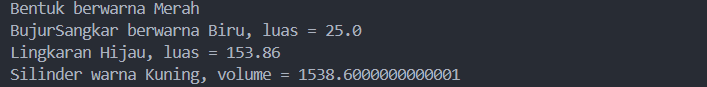

# Tugas-2
# Java OOP: Geometric Shape Program

Program ini merupakan implementasi Pemrograman Berorientasi Objek menggunakan Java untuk mengolah beberapa jenis bentuk geometri. Melalui program ini, konsep pewarisan class dan penggunaan method dengan perilaku berbeda dapat dipelajari.

## 🔍 Gambaran Program

Objek yang digunakan dalam program meliputi bentuk umum, bujur sangkar, lingkaran, dan silinder. Masing-masing objek memiliki informasi dan perhitungan tersendiri.

Program menerapkan konsep OOP agar atribut dan method dapat dikelompokkan sesuai tanggung jawab setiap class.

## 📦 Komponen Project

| Class          | Tanggung Jawab                                     |
| -------------- | -------------------------------------------------- |
| `Bentuk`       | Menjadi class dasar dan menyimpan informasi warna. |
| `BujurSangkar` | Mengelola panjang sisi dan menghitung luas.        |
| `Lingkaran`    | Mengelola radius dan menghitung luas lingkaran.    |
| `Silinder`     | Mengelola tinggi dan menghitung volume.            |
| `Main`         | Membuat objek dan menjalankan pengujian.           |

## 🧠 Konsep yang Dipelajari

**Encapsulation**
Atribut dibuat `private` agar akses terhadap data dilakukan melalui method yang disediakan.

**Inheritance**
Class turunan menggunakan `extends` untuk mewarisi fitur dari class induknya.

**Polymorphism**
Method `printInfo()` diimplementasikan kembali pada class turunan agar setiap objek menampilkan informasi sesuai jenisnya.

**Constructor**
Constructor memberikan nilai awal pada atribut objek. `super()` digunakan untuk memanggil constructor class induk.

## 📐 Perhitungan

- Luas bujur sangkar = sisi × sisi
- Luas lingkaran = π × radius × radius
- Volume silinder = luas alas × tinggi

## ▶️ Menjalankan Program

Jalankan perintah berikut melalui terminal di folder project:

```bash
javac *.java
java Main
```

## 🖥️ Hasil Program

Contoh output:

```text
Bentuk berwarna Merah
BujurSangkar berwarna Biru, luas = 25.0
Lingkaran Hijau, luas = 153.86
Silinder warna Kuning, volume = 1538.6
```

## 📸 Screenshot

Dokumentasi hasil eksekusi program:




Project ini dibuat sebagai dokumentasi latihan penerapan konsep OOP dalam Java.
